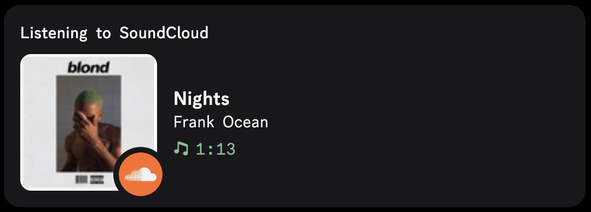

[](https://github.com/bloomcr4zy/SoundCloudPresence/releases/download/v1.0.0/SoundCloudPresence-1.0.0.zip)

# SoundCloudPresence

[English](README.en.md)

Mostre no Discord a faixa que você está ouvindo no SoundCloud. O plugin exibe título e artista e, quando encontra uma correspondência na busca pública do SoundCloud, adiciona a capa e o botão **Listen on SoundCloud**.



## Requisitos

- Windows ou macOS, Discord para desktop com [BetterDiscord](https://betterdiscord.app/) e [Node.js](https://nodejs.org/) 22 ou posterior.
- Uma conta no Last.fm, uma [chave da API do Last.fm](https://www.last.fm/api/account/create) e a extensão [Web Scrobbler](https://webscrobbler.com/).

## Instalação

1. No navegador, abra o Web Scrobbler e autorize sua conta do Last.fm. Toque uma faixa no SoundCloud e confirme que ela aparece como reprodução atual no seu perfil do Last.fm.
2. Baixe o ZIP na [página da release](https://github.com/bloomcr4zy/SoundCloudPresence/releases/latest) e extraia os arquivos. No Discord, vá em **Settings → BetterDiscord → Plugins → Open Plugin Folder** e copie [SoundCloudPresence.plugin.js](SoundCloudPresence.plugin.js) para essa pasta.
3. Abra o PowerShell (Windows) ou o Terminal (macOS) na pasta baixada e rode a ponte. Mantenha o terminal aberto enquanto usar o plugin.

   ```text
   node bridge.cjs
   ```

4. Ative **SoundCloudPresence** no BetterDiscord. Na engrenagem, informe seu usuário e sua chave de API do Last.fm e clique em **Save settings**. Se necessário, habilite o compartilhamento em **Settings → Activity Privacy**.

Se preferir abrir a pasta do plugin diretamente, use `%APPDATA%\BetterDiscord\plugins` no Windows ou `~/Library/Application Support/BetterDiscord/plugins` no macOS.

## Como funciona

O Web Scrobbler envia a reprodução do navegador ao Last.fm. O plugin consulta o Last.fm a cada cinco segundos entre verificações e usa a busca pública do SoundCloud para obter capa e link. A ponte repassa o resultado via Rich Presence ao Discord desktop. A ponte usa a aplicação compartilhada do projeto no Discord, com o ícone do SoundCloud já configurado. A busca pública dispensa token do SoundCloud.

Se a faixa aparecer sem capa, o SoundCloud pode estar sem imagem para aquele upload ou a busca pode ter retornado resultados ambíguos. A conta do Last.fm também pode receber faixas de outros serviços conectados.

## O que o comando executa

O comando `node bridge.cjs` executa o [arquivo da ponte](bridge.cjs) incluído neste repositório. A ponte usa apenas módulos do Node.js, lê a atividade que o plugin grava no computador e envia os dados ao Discord pelo canal local do aplicativo. Não instala pacotes, não pede permissões de administrador e não usa token da conta Discord. Você pode ler o arquivo antes de executar e encerrar a ponte com **Ctrl+C**.

O plugin consulta o Last.fm e o SoundCloud separadamente para obter a faixa e a imagem. A chave do Last.fm fica na configuração local do BetterDiscord.

## Licença

O código-fonte está disponível sob [MIT com Commons Clause 1.0](LICENSE). Você pode usar, modificar e redistribuir o projeto gratuitamente, mantendo os avisos da licença. A licença restringe a venda do software conforme a definição da Commons Clause. Versões publicadas anteriormente sob MIT continuam sob aquela licença.
